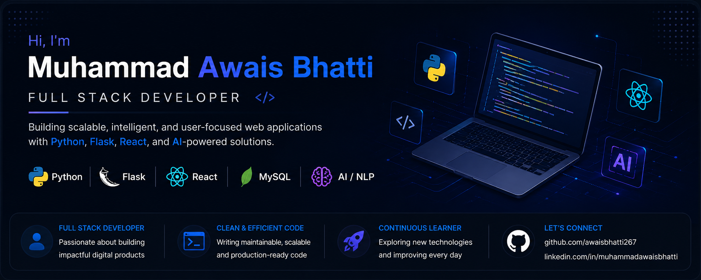

# Muhammad Awais Bhatti

## 🚀 Full Stack Developer | Python • Flask • React.js • Next.js • LLM & AI Applications

Full Stack Developer passionate about building AI-powered and scalable web applications using Python, Flask, React.js, Next.js, Node.js, REST APIs, and LLM integrations. Experienced in secure authentication systems, database management, resume-based AI pipelines, and responsive full-stack solutions with clean and maintainable code.

---

## 🛠 Tech Stack

### Languages & Frameworks

### AI & LLM Integration

### Databases & APIs

### Tools & Platforms

---

## 🔥 Featured Projects

### 📦 [Inventory Management System (POS)](https://github.com/awaisbhatti267/Inventory-Manager-v2.0) · [Live Demo](https://inventory-frontend-production-b20e.up.railway.app/)

Full-stack inventory and point-of-sale app with secure login, product management, a POS screen with automatic stock updates, printable receipts, and a sales history with invoice filters and returns. Built with **React 19, React Router v7, Tailwind CSS v4, Node.js, Express 5, and MySQL**, deployed on Railway.

### 🧠 [AI Interview Prep Simulator](https://github.com/awaisbhatti267/AI-Interview-Prep)

LLM-powered interview preparation platform using **Groq API (LLaMA 3.3 70B)** to generate topic-specific technical questions and deliver AI-driven answer evaluation with real-time feedback and scoring. Built with React.js, Flask, MySQL, JWT auth, OTP verification, resume skill extraction, weak topic detection, and performance analytics.

### 📄 [AI-Powered Resume Analyzer](https://github.com/awaisbhatti267/AI-Powered-Resume-Analyzer)

Full-stack AI application that analyzes PDF resumes using an LLM to extract skills, strengths, weaknesses, and job-fit recommendations. Built with React.js, Flask, MySQL, Groq API, and PyMuPDF.

### 🪧 [AL SAEED Name Plate Service](https://github.com/awaisbhatti267/AL-Saeed-Name-Plate-Service) · [Live Demo](https://al-saeed-name-plate-service.vercel.app/)

Responsive business website for a Lahore-based name plate manufacturer with product cards, an animated client strip, and an inquiry form with an embedded map. Built with **Next.js 15, React 19, and Tailwind CSS v4**, deployed on Vercel.

### 🐦 [X (Twitter) Clone](https://github.com/awaisbhatti267/X-Clone)

Pixel-accurate front-end clone of X's dark-mode UI with a three-column layout, responsive sidebar, mobile bottom navigation, trending topics, and dynamic profile routing. Built with **Next.js 15, React 19, Tailwind CSS v4, and Lucide React**.

### 🏥 Hospital Management System *(Under Development)*

Full-stack Hospital Management System built with **React.js, Tailwind CSS, Flask, MySQL**, REST APIs, JWT authentication, and bcrypt. Features patient management, appointment scheduling, and role-based access control.

### ⛓ [Blockchain Double-Spending Simulation](https://github.com/awaisbhatti267/Blockchain-Double-Spending-Simulation)

Python-based blockchain security simulation — Final Year Project — demonstrating double-spending attacks using Proof-of-Work concepts, transaction validation, mining workflows, and attack visualization.

### 🎮 [EA Software Engineering Virtual Experience](https://github.com/awaisbhatti267/EA-Software-Engineering-Virtual-Experience)

Proposed and implemented a new gameplay feature for EA Sports College Football using C++ and UML class diagrams. Applied OOP, software design, and debugging techniques in a real-world game development workflow.

---

## 💼 Experience

**Full Stack Web Development Intern** — Devarion Solutions *(Sep 2026 – Nov 2026)*
Building full-stack projects with React, Next.js, Node.js/Express, and MySQL, and working with MongoDB. Deployed apps to Vercel and Railway.

**Python Programming Intern** — DecodeLabs *(May 2026 – Jun 2026)*
Building Python-based applications focused on backend logic, API integration, data handling, and clean code practices.

**Full Stack Web Developer Intern** — Bank of Punjab *(Oct 2025 – Nov 2025)*
Developed full-stack features using React.js, Flask, and MySQL. Built and integrated REST APIs, responsive UIs, and managed database operations.

---

## 📚 Currently Learning

- System Design & API Security
- Docker & DevOps Basics
- Advanced LLM Integration & RAG
- Django
- MongoDB

---

## 🌐 Connect With Me

